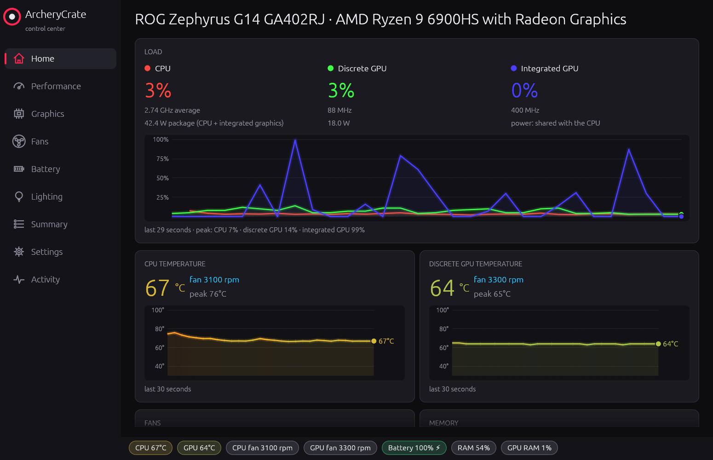
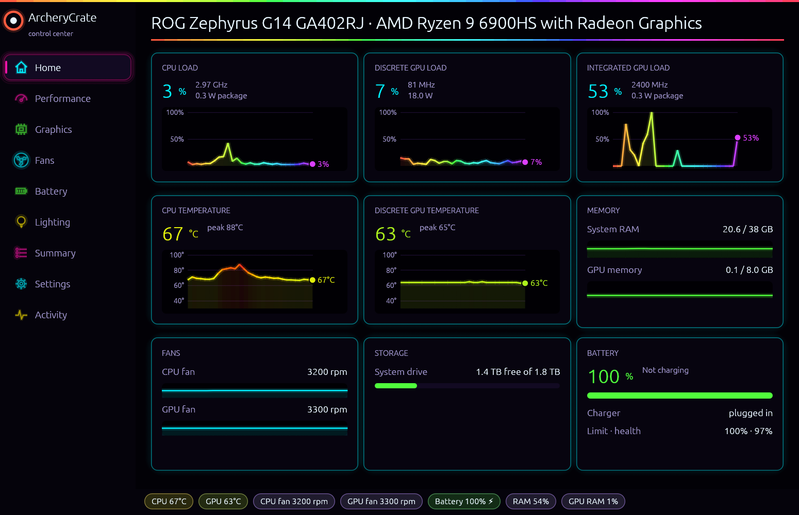
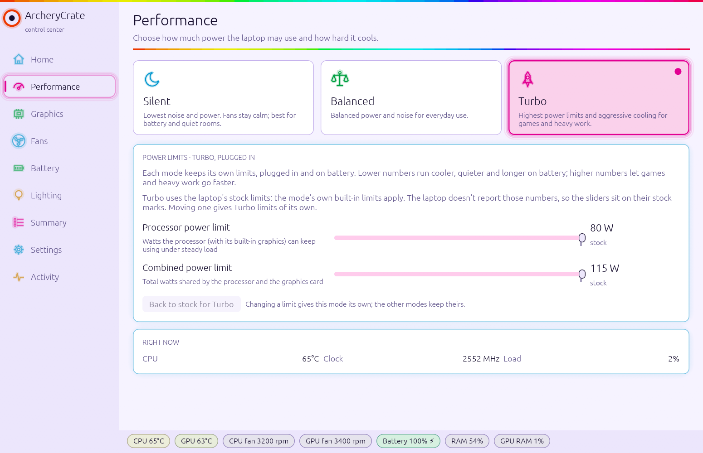

# ArcheryCrate

A control center for ASUS laptops on Linux, written in Rust (eframe/egui), built on top of
**asusctl** and **Cardwire**. Developed and tested on a 2022 ROG Zephyrus G14 (GA402RJ,
Ryzen 9 6900HS + Radeon RX 6700S) running CachyOS with KDE Plasma (Wayland).

| Home as a 3×3 grid (Neon) | Performance (Light Neon) |
|---|---|
|  |  |

## What it does

| Page        | What's there |
|-------------|--------------|
| Home        | The laptop at a glance: one combined load graph for the CPU and both GPUs (clock, power; an idle discrete GPU shows as asleep), temperatures with their fan speeds, combined fan and memory graphs, free space on each drive, battery with time left. Graphs cover the last 1, 5 or 15 minutes. A detailed scrolling layout or a 3×3 grid that fits the window. |
| Performance | Silent / Balanced / Turbo; each mode keeps its own *processor* and *combined* power limits (plugged in and on battery), with a stock mark and "Back to stock" |
| Graphics    | Eco / Standard (through Cardwire, instant both ways) and Ultimate (MUX, needs a restart; a waiting switch can be taken back) |
| Fans        | Pick a mode; drag the 8 points (fixed 30–100 °C columns) to make its fan curve yours; reset to stock |
| Battery     | Charge limit, one-time full charge, health; "on battery" automation: Silent mode, silent fans, Eco (skipped while HDMI is in use), 60 Hz, panel overdrive off, screen brightness, keyboard light off or dimmed |
| Lighting    | Keyboard effect, colours, speed, brightness, when it is lit |
| Summary     | Everything the app manages, as it stands now, in one list |
| Settings    | asusctl / Cardwire setup ("Install for me"), start at login, tray, theme (Follow system / Dark / Light / Neon / Light Neon), bold rainbow graphs, Home layout and graph range, interface size, panel overdrive, boot sound, version |
| Activity    | Every change made and what the system answered, including changes made by the tray icon |

The status bar shows CPU and GPU temperature, fan speeds, battery, and RAM and graphics-memory use.

The tray icon (its own small process, so closing the window keeps it) offers Open, performance
modes, graphics modes and Quit; switching to or from Ultimate asks with a notification (Restart
Now / Restart Later / Cancel). `--hidden` starts only the tray; "start at login" uses this.

Small screens (720p and up) work: with *Interface size: Auto* the pages scale down to fit.

## How changes are made

1. **asusctl** (and **Cardwire** for Eco/Standard) when installed. asusctl's printed errors count
   as failures even when it exits with 0.
2. The keyboard light goes through **logind** (no password).
3. Otherwise a **direct write to the kernel's settings files**, which asks for your password (pkexec).

Readings come straight from `/sys`, so the dashboard works without asusctl.

## Installing what it needs

Settings → *asusctl setup* detects your Linux and offers **Install for me**. On CachyOS/Arch:

    sudo pacman -S --needed asusctl cardwire && sudo systemctl enable --now asusd cardwired

## Building

    cargo build --release                 # the program: target/release/archerycrate
    packaging/build-appimage.sh           # packaging/out/ArcheryCrate-x86_64.AppImage
    packaging/build-flatpak.sh            # packaging/out/ArcheryCrate.flatpak (needs flatpak-builder)

The Flatpak reaches asusctl on the host through `flatpak-spawn --host`
(permission `--talk-name=org.freedesktop.Flatpak`); it is built for each release but hasn't been
tested on a real machine yet.

## Options

    archerycrate [--hidden] [--page <name>] [--theme system|dark|light|neon|neon-light] [--screenshot <file.png>]
